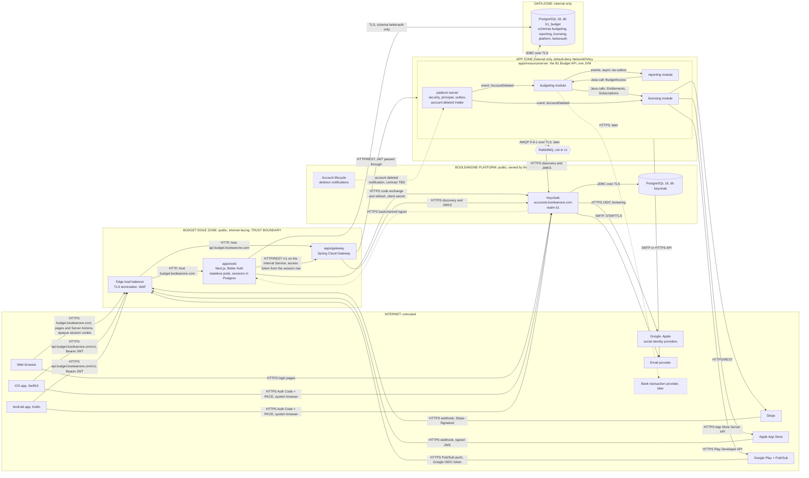
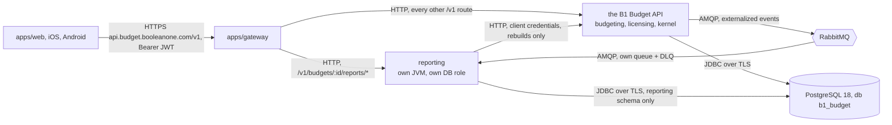

# B1 Budget: modular monolith architecture

Sep 29, 2026 · @Kristiyan. Revised Oct 4, 2026 against ADR-19 to ADR-40 and the repo as it stands.
[What this revision changes](#what-this-revision-changes) lists every correction with the decision
behind it. [`docs/DECISIONS.md`](DECISIONS.md) indexes the decisions and
[`docs/GLOSSARY.md`](GLOSSARY.md) defines the terms.

## Decisions at a glance

Ship one Spring Boot deployable, the B1 Budget API in `apps/resourceserver`, with three business
modules in one JVM behind Spring Cloud Gateway. Split a module into its own JVM only when a named
trigger fires (section 6). The budget is the tenant and the billable unit. Login runs on the
BooleanOne Keycloak at `accounts.booleanone.com`, realm `b1`, social logins included. The browser
never holds an OAuth token: the Next.js server in `apps/web` is the backend for frontend, keeps each
session in Postgres and hands the browser an opaque cookie. Versions as pinned in the repo: Java 25,
Spring Boot 4.1, Next.js 16, Better Auth 1.7, PostgreSQL 18. Spring Modulith 2.1 and Keycloak 26.x
are assumed.

| #   | Area                 | Recommendation                                                                                                                                                                                                                                                                                                                                                                         | Alternative, and when it wins                                                                                                                                   |
| --- | -------------------- | -------------------------------------------------------------------------------------------------------------------------------------------------------------------------------------------------------------------------------------------------------------------------------------------------------------------------------------------------------------------------------------- | --------------------------------------------------------------------------------------------------------------------------------------------------------------- |
| 1   | Backend shape        | One Spring Boot app, `apps/resourceserver`, one JVM behind the gateway. Modules are Java packages under `com.booleanone.budget`. Spring Modulith `verify()` runs in `pnpm test`, enforces the boundaries and rejects cycles.                                                                                                                                                           | One Gradle subproject per module, as the first step of extracting one (section 6). Not before: it adds build plumbing for a guarantee `verify()` already gives. |
| 2   | Tenancy and billing  | The budget is the tenant and the billable unit. Budgeting owns it, together with its owner, guests and invitations. Only the owner pays, guests take part for free, and a budget always ends with its owner.                                                                                                                                                                           | A separate membership module, if a second kind of shared object ever needs the same guests and invitations.                                                     |
| 3   | Module communication | Queries go through a module's public Java API. State changes cross modules as Spring application events, stored in Modulith's Event Publication Registry (a transactional outbox table in PostgreSQL).                                                                                                                                                                                 | Nothing better exists inside one JVM.                                                                                                                           |
| 4   | Message broker       | None in v1. The outbox already gives at-least-once delivery between modules.                                                                                                                                                                                                                                                                                                           | RabbitMQ over AMQP through Modulith event externalization, once any consumer runs outside the JVM. Kafka only if you need replayable streams.                   |
| 5   | Web login            | `apps/web` is the OIDC relying party, implemented with Better Auth (ADR-24). Each B1 Budget session is a row in Postgres keyed by the Keycloak session id and holds that session's own token pair (ADR-20, ADR-21). The browser gets an opaque, signed, HttpOnly session cookie that caches nothing (ADR-22). Reads happen in server components and writes in Server Actions (ADR-38). | None. Tokens in a cookie, a stateless BFF, and the gateway as BFF are all rejected by ADR-19, ADR-20 and ADR-24.                                                |
| 6   | Mobile login         | Online-only public clients `b1-budget-ios` and `b1-budget-android`, Authorization Code with PKCE in the system browser (AppAuth), rotating refresh tokens in Keychain or Keystore. Google and Apple sign-in happen on Keycloak's page.                                                                                                                                                 | DPoP-bound tokens, decided together with app attestation (open questions). Native Google and Apple buttons after launch, if sign-up conversion needs them.      |
| 7   | Token validation     | Gateway and API both validate, with one gate: issuer realm `b1`, `aud` contains `b1-budget-api`, `exp` present, 60 s skew. Nothing pins `azp` (ADR-25). The API alone decides authorization: scope `budget` at the endpoint and client role `budget-user` next to the work (ADR-27).                                                                                                   | Gateway-only validation. Rejected: one network misconfiguration then exposes every endpoint.                                                                    |
| 8   | Identity             | Realm `b1` on the platform Keycloak. B1 Budget owns its clients, the client scope `budget` and the client roles on `b1-budget-api`, applies them with Terraform, and holds no admin rights over users.                                                                                                                                                                                 | keycloak-config-cli in no-delete mode, if the platform team already manages the realm that way.                                                                 |
| 9   | Data                 | One database `b1_budget`, one schema per module plus `platform` and `betterauth`. No cross-schema joins or foreign keys. Rows in other schemas are referenced by id, and people by `sub`.                                                                                                                                                                                              | One PostgreSQL role and DataSource per module, as the first step when you extract a module.                                                                     |
| 10  | Migrations           | Flyway for the API, one folder and history table per schema. The API image runs them in migrate mode before each release, with a DDL role. Drizzle Kit for `betterauth`, as the repo does today.                                                                                                                                                                                       | Liquibase if you want rollback scripts or YAML changelogs.                                                                                                      |
| 11  | API contract         | OpenAPI 3.1 for `api.budget.booleanone.com/v1`, contract-first in `packages/api-contract`. Generate the Spring interfaces and the TypeScript, Kotlin and Swift clients. CI blocks breaking changes.                                                                                                                                                                                    | Code-first with springdoc, if the web app stays the only client through launch.                                                                                 |
| 12  | Repo tooling         | One monorepo, `b1-budget`. pnpm and Turborepo run every task, Gradle included, through a `package.json` shim per JVM project. Android keeps its own Gradle build and iOS its Xcode project, each behind the same kind of shim. Bitbucket Pipelines runs CI.                                                                                                                            | Nx with its Gradle plugin, if you want one affected-graph across languages and someone owns the Nx config.                                                      |

Infrastructure (clusters, networking, databases, secrets) lives in its own repository and is outside
this document. Where the design depends on it, the text says what it needs.

## What this revision changes

The 29 September draft predates ADR-19 to ADR-40. These are the corrections, each with the decision
or repository fact that forces it. Everything not listed here still holds.

| #   | The draft said                                                                                             | This revision says                                                                                                                                                                  | Because                                                                                                                |
| --- | ---------------------------------------------------------------------------------------------------------- | ----------------------------------------------------------------------------------------------------------------------------------------------------------------------------------- | ---------------------------------------------------------------------------------------------------------------------- |
| 1   | Tokens live in an encrypted `__Host-sid` cookie, the BFF is stateless, build it on `openid-client`.        | Each session is a Postgres row keyed by the Keycloak `sid`. The cookie is an opaque reference. Better Auth is the relying party.                                                    | ADR-20, ADR-21, ADR-22, ADR-24                                                                                         |
| 2   | The BFF forwards `/api/*` to the gateway for client components.                                            | Reads happen in server components and writes in Server Actions, through one data access layer and one API module. A handler that forwards a path is an open proxy and is forbidden. | ADR-32, ADR-38, ADR-40                                                                                                 |
| 3   | `aud=budget-api`, `azp` pinned to three clients, `jwk-set-uri` configured beside the issuer, 30 s skew.    | `aud` contains `b1-budget-api`, nothing pins `azp`, the JWKS location is discovered from the issuer, 60 s skew as a constant.                                                       | ADR-25                                                                                                                 |
| 4   | A revocation takes effect within 5 minutes.                                                                | A revoked session reaches the API for up to six minutes.                                                                                                                            | ADR-26                                                                                                                 |
| 5   | Ordinary users need no role. Scopes `budgets:read` and `budgets:write`.                                    | Every person needs client role `budget-user`, or they see a no-access page. One scope, `budget`.                                                                                    | ADR-27, ADR-35, `Scope.java`, `PrincipalService.java`                                                                  |
| 6   | A users module maps `sub` to an internal user id and copies the email.                                     | No users module. `sub` is the person in every schema. Display names are copies labelled as such.                                                                                    | ADR-27, glossary entry Principal                                                                                       |
| 7   | Clients `budget-web`, `budget-api`, `budget-ios`, `budget-android`.                                        | `b1-budget-web`, `b1-budget-api`, `b1-budget-ios`, `b1-budget-android`.                                                                                                             | The clients exist under these names                                                                                    |
| 8   | `budget-web` authenticates with `private_key_jwt`.                                                         | `b1-budget-web` uses a client secret, delivered by OpenBao as `BUDGET_OIDC_CLIENT_SECRET`.                                                                                          | Better Auth and the refresh routine send `client_secret`                                                               |
| 9   | Separate root Gradle build, Taskfile, `modules/` and `libs/`, GitHub workflows, local Keycloak in Compose. | Turbo drives Gradle through shims, code lives in `apps/` and `packages/`, Bitbucket Pipelines runs CI, local development logs into realm `b1`.                                      | Repo layout, ADR-28                                                                                                    |
| 10  | Refresh tokens are DPoP-bound in v1.                                                                       | DPoP is deferred and decided with app attestation.                                                                                                                                  | Keycloak binds the access token too, so the gateway and the API would have to verify proofs. Nothing in v1 needs that. |
| 11  | Back-channel and front-channel logout off. Logout elsewhere lands at the next failed refresh.              | Sign-out is RP-initiated logout and ends the SSO session. Backchannel logout deletes the session row.                                                                               | ADR-33, glossary entries RP-initiated logout and Backchannel logout                                                    |
| 12  | Marketing pages on `budget.booleanone.com` are anonymous.                                                  | The Proxy redirects every path off the public list to sign-in. The budget host has no anonymous pages; the marketing site lives elsewhere.                                          | ADR-32                                                                                                                 |
| 13  | Mobile app link files are served by the BFF.                                                               | Still true, and they need an exemption from the Proxy that does not exist yet. Today's matcher would redirect the operating system to sign-in.                                      | `apps/web/proxy.ts`                                                                                                    |

## 1. Component diagram

The trust boundary is the budget edge zone. Only two budget hostnames route from the internet, login
lives on the platform's Keycloak, and nothing in the app or data zones has a public route.



How to read it:

- The budget app has two public hostnames. `budget.booleanone.com` goes to the web app and
  `api.budget.booleanone.com` goes to the gateway.
- Keycloak belongs to the platform at `accounts.booleanone.com`, behind the platform's own edge. The
  budget edge routes nothing to it.
- Google and Apple sign-in happen on Keycloak's pages. The budget app only ever sees Keycloak
  tokens, never Google's or Apple's.
- The web app forwards no browser request to the API. Server components read and Server Actions
  write, both through the data access layer, and one module attaches the access token and spells
  the API base URL (ADR-38, ADR-40). The one exception is a Proxy Route Handler on a fixed path that
  moves bytes such as a file export. A handler that forwards an arbitrary path is an open proxy to
  the API carrying the user's token, and is forbidden.
- The web app also serves `/.well-known/apple-app-site-association` and
  `/.well-known/assetlinks.json`, and the landing pages for the mobile callback URLs. The operating
  system fetches them with no cookie, so they belong on the Proxy's public list (ADR-32). Today's
  matcher in `apps/web/proxy.ts` excludes neither, and would answer with a redirect to sign-in.
- Webhooks from Stripe, Apple and Google arrive at `api.budget.booleanone.com/webhooks/{stripe,apple,google}`.
  The gateway skips JWT checks on that path, and the licensing module verifies the provider
  signature before it reads the payload.
- The API's protected resource metadata at `/.well-known/oauth-protected-resource` is public by
  design (ADR-30). The gateway routes it without a token and never rewrites it, and passes the
  API's `WWW-Authenticate` challenges through untouched (ADR-29).
- No browser calls `api.budget.booleanone.com`, so the gateway sends no CORS headers at all (ADR-39).
- The API accepts traffic only from gateway pods. Its actuator listens on a separate management port
  that no route exposes.
- A second, weaker boundary sits between gateway and API. The API treats the gateway hop as
  untrusted and validates every token again.
- TLS ends at the edge. In-cluster hops are plain HTTP except Keycloak and database traffic. Add a
  mesh with mTLS if your compliance scope needs encryption inside the cluster.

### Module map

| Module                                | Owns                                                                                                                                                                                                                                                   | Public API (in-process)                                                                                                                                                    | Publishes                                                                                                                                                                 | Consumes                                    |
| ------------------------------------- | ------------------------------------------------------------------------------------------------------------------------------------------------------------------------------------------------------------------------------------------------------ | -------------------------------------------------------------------------------------------------------------------------------------------------------------------------- | ------------------------------------------------------------------------------------------------------------------------------------------------------------------------- | ------------------------------------------- |
| budgeting                             | The budget as tenant (name, currency, owner, guests, invitations) and everything in it: accounts, categories, monthly assignments, transactions, scheduled transactions, targets                                                                       | `BudgetAccess.require(subject, budgetId)`, `BudgetAccess.requireOwner(…)`, `BudgetExport` (paged read for projection rebuilds)                                             | `BudgetCreated`, `BudgetDeleted`, `MemberJoined`, `MemberRemoved`, `TransactionRecorded`, `TransactionChanged`, `TransactionDeleted`, `CategoryChanged`, `AccountChanged` | `AccountDeleted`                            |
| reporting                             | Report read models                                                                                                                                                                                                                                     | None. Only its own REST controllers use it.                                                                                                                                | None                                                                                                                                                                      | Budgeting events                            |
| licensing                             | Plans, one subscription per budget from Stripe, App Store or Play, entitlements, trials                                                                                                                                                                | `Entitlements.canWrite(budgetId)`, `Subscriptions.startTrial(…)`, `Subscriptions.checkout(budgetId, ownerSubject, store)`, `Subscriptions.closeForDeletedBudget(budgetId)` | `EntitlementChanged`                                                                                                                                                      | `AccountDeleted` (payer records)            |
| platform (shared kernel, open module) | `Money`, typed ids (`BudgetId`, `Subject`), the RFC 9457 error model, the resource server security configuration and principal resolution that live in `security` and `principal` today, outbox and lock tables, the platform's account-deleted intake | Open to every module                                                                                                                                                       | `AccountDeleted`                                                                                                                                                          | The platform's account-deleted notification |

Allowed dependencies are reporting → budgeting, budgeting → licensing, and every module → platform.
Any other dependency, including a reverse one, fails `verify()`. Licensing never calls or listens to
budgeting, and that keeps the graph acyclic. Budgeting drives it instead: its own after-commit
listeners on `BudgetCreated` and `BudgetDeleted` call licensing to start the trial and close the
subscription, so each transaction still writes to one module.

There is no users module. The draft justified one with a mapping from Keycloak's `sub` to an
internal user id, so that a change of identity provider would touch one table. ADR-27 and the
glossary fix the principal to `sub` and nothing else, and the realm is shared, so any identity
migration is the platform's and would have to preserve `sub` for every product anyway. With the
mapping gone the module kept an email copy, which the glossary forbids as a stand-in, plus
preferences and consent that v1 does not need. What remains is the account-deleted intake, which is
infrastructure without business rules and sits in the kernel, so both budgeting and licensing can
listen to it without a new edge in the graph. The one thing the product still needs from a person
beyond `sub` is a name to show next to a guest, and that is a display copy owned by budgeting
(section 3).

### Deployables

| Deployable    | Built from            | What it runs                                                                                                                      |
| ------------- | --------------------- | --------------------------------------------------------------------------------------------------------------------------------- |
| web image     | `apps/web`            | Next.js pages, Server Actions, the Proxy, and Better Auth's routes under `/api/auth/*`                                            |
| gateway image | `apps/gateway`        | Spring Cloud Gateway                                                                                                              |
| API image     | `apps/resourceserver` | The B1 Budget API: three modules and the kernel in one JVM. Started in migrate mode, the same image runs Flyway before a release. |
| iOS app       | `apps/ios`            | App Store build                                                                                                                   |
| Android app   | `apps/android`        | Play Store build                                                                                                                  |

What the design needs from infrastructure: two or more stateless replicas of each image (hence
ShedLock for scheduled jobs), the migrate step before each release, PostgreSQL 18 with one role per
deployable, network rules that let only the gateway reach the API, and OpenBao delivering every
runtime secret as an environment variable (ADR-12).

## 2. Interface overview

Seven interfaces face the internet on the two budget hostnames, and the platform's
`accounts.booleanone.com` adds login. Everything else is cluster-internal, outbound or owned by the
platform.

| Interface                                                                                                                                   | Provider                       | Consumer(s)                                                                                         | Protocol                                                                                                     | Public / internal                                        | Auth mechanism                                                                                                                                                                                                                                                  |
| ------------------------------------------------------------------------------------------------------------------------------------------- | ------------------------------ | --------------------------------------------------------------------------------------------------- | ------------------------------------------------------------------------------------------------------------ | -------------------------------------------------------- | --------------------------------------------------------------------------------------------------------------------------------------------------------------------------------------------------------------------------------------------------------------- |
| Web pages, `budget.booleanone.com/*`                                                                                                        | `apps/web`                     | Browser                                                                                             | HTTPS                                                                                                        | Public                                                   | Better Auth's session cookie: a signed, opaque reference to a Postgres row, HttpOnly, Secure, SameSite=Lax, caching nothing (ADR-22). The Proxy maintains the session on every path off the public list and redirects a caller without one to sign-in (ADR-32). |
| Server Actions, POST to the page URL                                                                                                        | `apps/web`                     | Browser                                                                                             | HTTPS                                                                                                        | Public                                                   | Session cookie, plus Next's check that `Origin` matches `Host` on every action. The only write path from the browser (ADR-38).                                                                                                                                  |
| Auth routes, `/api/auth/*`                                                                                                                  | `apps/web`, Better Auth        | Browser; Keycloak for backchannel logout                                                            | HTTPS redirects and POST                                                                                     | Public, on the public list                               | OIDC state, nonce and PKCE verifier held by Better Auth. Callback `/api/auth/oauth2/callback/keycloak`. The backchannel logout endpoint verifies Keycloak's signed logout token against realm `b1`'s keys.                                                      |
| Sign-in page, `/sign-in`                                                                                                                    | `apps/web`                     | Browser                                                                                             | HTTPS                                                                                                        | Public, on the public list                               | None. It always renders, names why you are there and keeps `returnTo` (ADR-36, ADR-37).                                                                                                                                                                         |
| Proxy Route Handlers, fixed paths such as `/export/{budgetId}`                                                                              | `apps/web`, then the API       | Browser                                                                                             | HTTPS, bytes                                                                                                 | Public                                                   | Session cookie. The handler attaches the bearer through the same API module as every other call and forwards one fixed path, never a caller-supplied one.                                                                                                       |
| App link files, `/.well-known/apple-app-site-association` and `/.well-known/assetlinks.json`; landing pages `/oauth/{ios,android}/callback` | `apps/web`                     | iOS, Android (operating system)                                                                     | HTTPS                                                                                                        | Public, on the public list                               | None. The files bind the login redirect URLs to the signed apps. The landing pages only tell a visitor without the app to install it.                                                                                                                           |
| Public API, `api.budget.booleanone.com/v1/*`                                                                                                | `apps/gateway`, then the API   | iOS, Android, `apps/web`                                                                            | HTTPS/REST, JSON, OpenAPI 3.1                                                                                | Public for mobile. `apps/web` uses the internal Service. | Bearer JWT from realm `b1` with `aud` containing `b1-budget-api`, scope `budget`, and client role `budget-user` under `resource_access.b1-budget-api`.                                                                                                          |
| Protected resource metadata, `api.budget.booleanone.com/.well-known/oauth-protected-resource`                                               | The API, through the gateway   | Any client                                                                                          | HTTPS, RFC 9728                                                                                              | Public                                                   | None. Names the configured resource URI and realm `b1` as the authorization server (ADR-30).                                                                                                                                                                    |
| Webhooks, `api.budget.booleanone.com/webhooks/{stripe,apple,google}`                                                                        | `apps/gateway`, then licensing | Stripe, Apple, Google Pub/Sub                                                                       | HTTPS POST                                                                                                   | Public                                                   | Stripe-Signature HMAC. Apple signed JWS with x5c chain to Apple's root CA. Google OIDC token with audience and service account checked. No Keycloak.                                                                                                            |
| OIDC endpoints, `accounts.booleanone.com/realms/b1/protocol/openid-connect/*`                                                               | Platform Keycloak              | Browser, iOS, Android, `apps/web`                                                                   | HTTPS, OAuth 2.0 / OIDC                                                                                      | Public, platform-owned                                   | PKCE S256 for every budget client, client secret for `b1-budget-web`.                                                                                                                                                                                           |
| Login, registration and social sign-in pages, `/realms/b1/login-actions/*`, `/realms/b1/broker/{google,apple}/endpoint`                     | Platform Keycloak              | End users, and Google and Apple redirecting back                                                    | HTTPS                                                                                                        | Public, platform-owned                                   | Keycloak SSO cookies, brute-force detection. Keycloak validates the provider's response.                                                                                                                                                                        |
| Social identity providers                                                                                                                   | Google, Apple                  | Platform Keycloak                                                                                   | OIDC                                                                                                         | Outbound, platform-owned                                 | Keycloak's client registration with each provider. Apple's client secret is an ES256-signed JWT.                                                                                                                                                                |
| Discovery and JWKS, `/realms/b1/.well-known/openid-configuration` and `/protocol/openid-connect/certs`                                      | Platform Keycloak              | `apps/gateway`, the API, `apps/web`                                                                 | HTTPS                                                                                                        | Public, platform-owned                                   | None, public keys only. The JWKS location is discovered from the issuer, never configured beside it (ADR-25). Keys are cached for five minutes.                                                                                                                 |
| Admin REST API, `b1-budget-*` clients only                                                                                                  | Platform Keycloak              | CI Terraform job                                                                                    | HTTPS/REST                                                                                                   | Internal to CI                                           | `b1-budget-terraform` client credentials, limited to the budget clients through fine-grained admin permissions. The running app has no admin access.                                                                                                            |
| Account-deleted notification                                                                                                                | BooleanOne platform            | Kernel                                                                                              | To agree with the platform. Proposal: signed HTTPS webhook to `api.budget.booleanone.com/webhooks/platform`. | Public or internal, depending on where the platform runs | Signed JWT from the platform, verified against its JWKS                                                                                                                                                                                                         |
| Backchannel logout                                                                                                                          | Platform Keycloak              | `apps/web`                                                                                          | HTTPS POST                                                                                                   | Public, on the public list                               | Signed logout token from realm `b1`, carrying the `sid` whose row is deleted.                                                                                                                                                                                   |
| API upstream, `resourceserver.app.svc:8080`                                                                                                 | The API                        | `apps/gateway` only                                                                                 | HTTP/REST                                                                                                    | Internal                                                 | Same user JWT, validated again. Network rules admit only gateway pods.                                                                                                                                                                                          |
| Module APIs, e.g. `BudgetAccess`, `Entitlements`                                                                                            | Each module                    | Other modules                                                                                       | In-process Java call                                                                                         | Internal, same JVM                                       | None. The caller passes the `Subject` explicitly.                                                                                                                                                                                                               |
| Module events, e.g. `TransactionRecorded`                                                                                                   | Publishing module              | Consuming modules                                                                                   | Spring events persisted in `platform.event_publication`                                                      | Internal, same JVM                                       | None                                                                                                                                                                                                                                                            |
| Database `b1_budget`                                                                                                                        | PostgreSQL 18                  | The API as `b1_budget_api`, the migrate step as `b1_budget_migrator`, `apps/web` as `b1_budget_web` | TLS                                                                                                          | Internal                                                 | SCRAM-SHA-256, `hostssl` only, credentials delivered by OpenBao. `b1_budget_web` sees schema `betterauth` and nothing else.                                                                                                                                     |
| Stripe API                                                                                                                                  | Stripe                         | licensing                                                                                           | HTTPS/REST                                                                                                   | Outbound                                                 | Restricted secret key                                                                                                                                                                                                                                           |
| App Store Server API                                                                                                                        | Apple                          | licensing                                                                                           | HTTPS/REST                                                                                                   | Outbound                                                 | ES256 JWT signed with an App Store Connect API key                                                                                                                                                                                                              |
| Google Play Developer API                                                                                                                   | Google                         | licensing                                                                                           | HTTPS/REST                                                                                                   | Outbound                                                 | Service account, OAuth 2.0                                                                                                                                                                                                                                      |
| Email                                                                                                                                       | Email provider                 | The API                                                                                             | SMTP with STARTTLS, or HTTPS API                                                                             | Outbound                                                 | SMTP credentials or API key                                                                                                                                                                                                                                     |
| Health and metrics, `:8081/actuator`                                                                                                        | Each JVM                       | Kubelet probes, Prometheus                                                                          | HTTP                                                                                                         | Internal, never routed                                   | Separate management port, network rules                                                                                                                                                                                                                         |
| Message broker, later                                                                                                                       | RabbitMQ                       | The API, extracted services                                                                         | AMQP 0-9-1 over TLS                                                                                          | Internal                                                 | One broker user per service                                                                                                                                                                                                                                     |

## 3. Database schemas

One PostgreSQL 18 instance holds database `b1_budget` with five schemas: one per module, `platform`
for the kernel, and `betterauth` for the web app's sessions. The platform's Keycloak keeps its own
PostgreSQL 18, which the budget app never touches.

| Schema              | Owner               | Holds                                                                                                                                                               |
| ------------------- | ------------------- | ------------------------------------------------------------------------------------------------------------------------------------------------------------------- |
| `budgeting`         | budgeting module    | Budgets with their owner, guests and invitations, and all budget data                                                                                               |
| `reporting`         | reporting module    | Read models built from budgeting events                                                                                                                             |
| `licensing`         | licensing module    | Plans, per-budget subscriptions, entitlements, store notifications                                                                                                  |
| `platform`          | Shared kernel       | Outbox (`event_publication`), `shedlock`, `idempotency_key`                                                                                                         |
| `betterauth`        | `apps/web`          | Better Auth's `user`, `session`, `account` and `verification` tables. The session row keyed by the Keycloak `sid` holds that session's token pair (ADR-20, ADR-21). |
| Keycloak's database | BooleanOne platform | Off-limits to the budget app                                                                                                                                        |

`betterauth` shares the instance because the instance is fixed, and shares the database because a
role already confines `b1_budget_web` to its schema and nothing in the web app's path needs more.
A database of its own is the alternative if backups or connection budgets for the web app need to
move separately. It is not a module schema: the API never reads it, and the web app never reads a
module schema. Product data crosses that line only through the API.

Conventions for every API schema:

- Primary keys are `uuid` with default `uuidv7()`, which PostgreSQL 18 ships natively. They sort by
  creation time, which keeps index inserts cheap. The server generates them, since the apps are
  online-only.
- People are their `sub`, stored as `text` in a column named `subject` or `<role>_subject`. There is
  no user table to join to, and no column carries an email or username to identify someone (ADR-27).
- Money is `bigint` in milliunits, so 1.00 is stored as 1000. That also covers three-decimal
  currencies. The currency is a fixed property of the budget, and nothing converts between
  currencies.
- Every budgeting table carries `budget_id`, and child foreign keys include it, e.g.
  `(budget_id, account_id)`. The database then rejects a row that points into another budget.
- Every mutable row has a `version` column. Clients send it back as `If-Match` and get 412 when
  another member changed the row first.

### budgeting

| Table              | Main columns                                                                                                                 | Relationships                                                                                                                                                                   |
| ------------------ | ---------------------------------------------------------------------------------------------------------------------------- | ------------------------------------------------------------------------------------------------------------------------------------------------------------------------------- |
| `budget`           | id, name, currency_code, owner_subject, first_month, status (active, deleted), created_at                                    | The tenant and the billable unit. Root of every table below. The currency is set at creation and never changes.                                                                 |
| `budget_member`    | budget_id, subject, role (owner, guest), display_name, joined_at                                                             | PK (budget_id, subject). Exactly one owner. Guests read and edit everything. `display_name` is a copy of the token's `name` claim, taken at join and refreshed on each request. |
| `invitation`       | id, budget_id, token_hash, invited_email, invited_by_subject, expires_at, accepted_at, accepted_by_subject                   | budget 1:n invitation. Only the hash of the link token is stored. `invited_email` is where the link was sent, never who may accept it.                                          |
| `account`          | id, budget_id, name, type, on_budget, closed, cleared_balance_mu, uncleared_balance_mu                                       | budget 1:n account. Balances change in the same transaction as the `txn` write.                                                                                                 |
| `category_group`   | id, budget_id, name, sort_order, hidden                                                                                      | budget 1:n category_group                                                                                                                                                       |
| `category`         | id, budget_id, group_id, name, sort_order, hidden                                                                            | category_group 1:n category                                                                                                                                                     |
| `month_assignment` | budget_id, category_id, month, assigned_mu                                                                                   | PK (budget_id, category_id, month)                                                                                                                                              |
| `category_target`  | id, budget_id, category_id, kind, amount_mu, due_month, cadence                                                              | category 1:0..1 target                                                                                                                                                          |
| `payee`            | id, budget_id, name, transfer_account_id                                                                                     | A transfer payee points at an account                                                                                                                                           |
| `txn`              | id, budget_id, account_id, date, amount_mu, payee_id, category_id, memo, cleared, approved, flag, transfer_txn_id, import_id | account 1:n txn. `transfer_txn_id` pairs both sides of a transfer. Unique (account_id, import_id) dedupes imports.                                                              |
| `txn_split`        | id, budget_id, txn_id, amount_mu, category_id, payee_id, memo                                                                | txn 1:n split. The parent's `category_id` is null when split.                                                                                                                   |
| `scheduled_txn`    | id, budget_id, account_id, next_date, frequency, amount_mu, payee_id, category_id                                            | account 1:n scheduled_txn                                                                                                                                                       |
| `reconciliation`   | id, budget_id, account_id, reconciled_at, cleared_balance_mu, adjustment_txn_id                                              | account 1:n reconciliation                                                                                                                                                      |

Only the owner can manage billing, invite or remove guests and delete the budget. Ownership never
moves, so a budget always ends with its owner. An invitation link works once and expires after 7
days. Whoever opens it while signed in becomes a guest, and the owner sees who joined and can remove
them. The invited email is not matched, because Apple sign-in often hides the real address behind a
relay address, and because an email may not stand in for a person (ADR-27). When the owner deletes
their budget data, in the app or through the platform, budgeting deletes every budget they own,
guests lose access, and budgeting tells licensing to close the subscription.

The apps are online-only and refresh on pull, so there is no sync protocol, change counter or
tombstone table. If two members edit the same row, the second write gets 412 and the client reloads.
"Available" per category is computed from `month_assignment` and `txn`, not stored.

### reporting

| Table                     | Main columns                                              | Filled by                                       |
| ------------------------- | --------------------------------------------------------- | ----------------------------------------------- |
| `dim_account`             | budget_id, account_id, name, type, on_budget              | `AccountChanged`                                |
| `dim_category`            | budget_id, category_id, group_name, category_name, hidden | `CategoryChanged`                               |
| `category_month_activity` | budget_id, category_id, month, activity_mu                | Transaction events                              |
| `payee_month_outflow`     | budget_id, payee_id, month, outflow_mu                    | Transaction events                              |
| `income_expense_month`    | budget_id, month, income_mu, expense_mu                   | Transaction events                              |
| `account_balance_day`     | budget_id, account_id, day, balance_mu                    | Transaction events. Feeds the net worth report. |
| `processed_event`         | event_id, processed_at                                    | Dedupe for at-least-once delivery               |

Reporting has no foreign keys into budgeting. It copies names into the `dim_` tables and keeps them
current from events. The outbox is not an event store, so a rebuild deletes a budget's reporting
rows and replays them through `BudgetExport`.

I recommend projections because reporting is the module most likely to move out first, and its
scans shouldn't touch budgeting's tables. The alternative is for reporting to ask budgeting for
aggregates through its Java API. That is simpler while reports are few, but report SQL then lives in
budgeting and reporting can't be extracted without a rewrite.

### licensing

| Table                | Main columns                                                                                                  | Relationships                                                                                                                                                                                                 |
| -------------------- | ------------------------------------------------------------------------------------------------------------- | ------------------------------------------------------------------------------------------------------------------------------------------------------------------------------------------------------------- |
| `plan`               | code, name, interval, features (jsonb)                                                                        | Catalog                                                                                                                                                                                                       |
| `store_product`      | store (stripe, app_store, play), store_product_id, plan_code                                                  | store_product n:1 plan                                                                                                                                                                                        |
| `payer`              | subject, stripe_customer_id                                                                                   | One per paying owner. An owner paying for two budgets is one Stripe customer.                                                                                                                                 |
| `purchase_intent`    | id, budget_id, subject, store, created_at                                                                     | Created before every in-app purchase. iOS passes `id` to StoreKit as `appAccountToken`, Android as `obfuscatedAccountId`, so store notifications map back to the budget.                                      |
| `subscription`       | id, budget_id, payer_subject, store, store_subscription_id, plan_code, status, current_period_end, auto_renew | Unique (store, store_subscription_id). A partial unique index allows one live subscription per budget. Status is trialing, active, grace_period, billing_retry, expired or revoked.                           |
| `entitlement`        | budget_id, plan_code, source (trial, subscription, grant), source_id, valid_until                             | What `Entitlements.canWrite(budgetId)` reads. Recomputed whenever a subscription changes.                                                                                                                     |
| `trial`              | subject, budget_id, started_at, ends_at                                                                       | PK subject, so one trial per person, ever, on the first budget they own. Later budgets need a subscription from the start. The row outlives the person's budget data, or deleting data would reset the trial. |
| `store_notification` | id, store, notification_id, received_at, payload (verified jsonb), processed_at                               | Unique (store, notification_id) makes webhooks idempotent                                                                                                                                                     |

A subscription belongs to a budget, and only its owner pays. Apple and Google require their own
in-app purchase for digital subscriptions sold inside the apps in most markets, and they tie the
subscription to the owner's store account. When a budget is deleted, licensing cancels a Stripe
subscription right away and a Google Play subscription through the Play Developer API. Apple offers
no server-side cancel, so the deletion flow must tell the owner to cancel in their Apple ID settings
first. When an entitlement lapses, the budget turns read-only instead of disappearing.

### platform

| Table                               | Purpose                                                                                                                                                   |
| ----------------------------------- | --------------------------------------------------------------------------------------------------------------------------------------------------------- |
| `event_publication` and its archive | Spring Modulith registry. One row per event per listener, marked complete after the listener commits.                                                     |
| `shedlock`                          | Lets one replica at a time run each scheduled job                                                                                                         |
| `idempotency_key`                   | subject, key, request_hash, response, expires_at. Lets a client retry a POST on a flaky mobile connection without creating a duplicate transaction.       |
| `account_deletion`                  | subject, source (in_app, platform), notification_id, requested_at, completed_at. Dedupes the platform's notification and publishes `AccountDeleted` once. |

### betterauth

Owned by `apps/web`, defined in `apps/web/drizzle/schemas/auth-schema.ts` and migrated with
Drizzle Kit. The API never reads it.

| Table          | Purpose                                                                                                                                                                                                                    |
| -------------- | -------------------------------------------------------------------------------------------------------------------------------------------------------------------------------------------------------------------------- |
| `user`         | Better Auth's person record: id, name, email, image. Display data for the web app only. It never reaches the API and never stands in for `sub`.                                                                            |
| `session`      | One row per SSO session, `id` = Keycloak `sid`, `token` = the opaque cookie value, `subject`, the access, refresh and ID tokens with their expiries, and `expires_at` capped at 30 days and never past the refresh expiry. |
| `account`      | Links a `user` to `(issuer, sub)`. A check constraint keeps every credential column null, so tokens live only on the session row (ADR-20, ADR-40).                                                                         |
| `verification` | Better Auth's short-lived OIDC state                                                                                                                                                                                       |

### Rules for cross-module data access

1. A module reads and writes only its own schema. No cross-schema joins, foreign keys, views or
   triggers.
2. A module references another module's rows by ID only, as plain `uuid` columns, and people by
   `sub`. Cleanup follows events such as `BudgetDeleted` and `AccountDeleted`.
3. Synchronous reads go through the owning module's public Java API. Anything that can lag keeps a
   local copy fed by the owner's events.
4. One module writes per transaction. A use case spanning modules commits locally and publishes an
   event. Listeners (`@ApplicationModuleListener`) run after commit, each in its own transaction.
5. Listeners are idempotent. The registry delivers at least once and republishes incomplete events
   after a restart.
6. Event classes belong to the publisher's API (an `events` named interface) and carry IDs plus
   changed values, never entities.
7. The build enforces this: `ApplicationModules.of(BudgetApplication.class).verify()` in the tests,
   an ArchUnit rule that a schema's tables are referenced only from its module, and CODEOWNERS on
   each migration folder.
8. `b1_budget_migrator` owns the API schemas and runs DDL, from the migration Job only.
   `b1_budget_api` gets USAGE and DML on the four API schemas and no DDL. `b1_budget_web` gets USAGE
   and DML on `betterauth` and nothing else, and Drizzle Kit migrates it with its own DDL role.
   Per-module roles come when a module is prepared for extraction.
9. Nothing in the budget app reads the platform's Keycloak database. Identity reaches the app
   through tokens, and account deletions through the platform's notification.

## 4. Monorepo structure

One repository, `b1-budget`. pnpm scripts run Turbo, and Turbo runs every task in every language,
so `pnpm build`, `pnpm test` and `pnpm lint` cover the whole tree. Each JVM project carries a small
`package.json` whose scripts call `./gradlew`, a symlink to the root wrapper, and Gradle scopes the
task to that directory. The root Gradle build already exists and lists the JVM projects. There is
no Taskfile, and the infrastructure stays in its own repository.

```text
b1-budget/
├── package.json, pnpm-workspace.yaml, turbo.json    pnpm scripts run Turbo. Turbo runs everything, Gradle included
├── settings.gradle.kts, build.gradle.kts            the one Gradle build. include() every JVM project
├── gradle/libs.versions.toml                        every JVM version. A version string in a build.gradle.kts is a bug
├── bitbucket-pipelines.yml                          CI. Steps run on changesets per path
├── apps/
│   ├── web/                                         Next.js, Better Auth, Drizzle (pnpm)
│   │   ├── app/                                     pages, Server Actions, api/auth/[...all]
│   │   ├── proxy.ts                                 the Proxy: maintains the session, forwards nothing
│   │   ├── lib/dal.ts                               the data access layer
│   │   ├── lib/api/                                 the one module that calls the API
│   │   ├── lib/auth/                                relying party, refresh routine, session proxy
│   │   ├── drizzle/                                 betterauth schema and migrations
│   │   └── public/.well-known/                      apple-app-site-association, assetlinks.json
│   ├── resourceserver/                              the B1 Budget API. package.json shim, gradlew symlink
│   │   └── src/main/
│   │       ├── java/com/booleanone/budget/
│   │       │   ├── BudgetApplication.java
│   │       │   ├── platform/                        shared kernel, open module. security/, principal/ move here
│   │       │   ├── budgeting/                       BudgetAccess.java, events/, web/, internal/
│   │       │   ├── reporting/                       same layout
│   │       │   └── licensing/
│   │       └── resources/db/migration/{platform,budgeting,reporting,licensing}/
│   ├── gateway/                                     Spring Cloud Gateway. Same shim and symlink
│   ├── android/                                     own Gradle build (AGP). Shim runs its ./gradlew
│   └── ios/                                         Xcode project, SwiftUI. Shim runs xcodebuild, macOS runners only
│       └── Packages/BudgetAPI, BudgetAuth           generated client; AppAuth wrapper, Keychain storage
├── packages/
│   ├── api-contract/openapi/budget-api.yaml         public REST contract, source of truth. Shim runs oasdiff
│   ├── api-client/                                  generated TypeScript client, consumed only by apps/web/lib/api
│   ├── ui/                                          shared React components
│   ├── typescript-config/, oxlint-config/, oxlint-plugin-react-best-practices/
│   └── design-tokens/                               later: colours, type, spacing for web, iOS, Android
├── identity/keycloak/terraform/                     budget clients, scope and roles in realm b1
├── docs/                                            DECISIONS.md, GLOSSARY.md, this document
├── compose.yaml                                     later: one PostgreSQL 18 for local development. No local Keycloak
└── CODEOWNERS
```

Both tools list their members explicitly, Gradle with `include(...)` and pnpm with the globs in
`pnpm-workspace.yaml`, so JVM and TypeScript projects share `apps/` and `packages/` without either
tool picking up the other's folders. Android keeps its own `settings.gradle.kts` and stays out of
the root build. Nothing moves to a `budget/` or `modules/` folder, and nothing gets a second root
build.

### Shared libraries vs module-local code

Shared code:

- `packages/api-contract` is the API contract. The generated clients (`packages/api-client`, iOS
  `BudgetAPI`, Android `core/network`) are build outputs that nobody edits by hand. In the web app
  only `lib/api` imports the generated client (ADR-40).
- The kernel package `platform` holds code with no business rules that two or more modules need.
  That means `Money`, typed IDs (`Subject`, `BudgetId`), the RFC 9457 problem-details error model,
  the resource server configuration and principal resolution that live in the `security` and
  `principal` packages today, observability setup, the outbox and ShedLock configuration, and the
  account-deleted intake. The kernel never depends on a module.
- The version catalog, `packages/typescript-config`, `packages/oxlint-config` and, later,
  `packages/design-tokens`.

Module-local code:

- Entities, repositories, SQL, migrations, domain services, controllers, event listeners and module
  config.
- Event classes, in the publisher's `events` package. A shared events library becomes a hub every
  module must upgrade in lock-step.
- Mapping between generated API DTOs and domain types.

One test decides the borderline cases. If a class would change when one module's business rules
change, it belongs in that module.

### Build tooling

- Turbo is the task runner for every language. A JVM project is visible to it through its
  `package.json` shim, so `pnpm build` runs `next build` and `./gradlew build` with one cache and one
  dependency graph. Spring Modulith, Spring Cloud Gateway and Flyway enter `gradle/libs.versions.toml`
  as `libs.` accessors like everything else.
- Modules are packages, not Gradle subprojects. Spring Modulith `verify()` rejects a dependency
  cycle and an access to another module's internals at test time, which is the guarantee the draft
  wanted from Gradle. Lifting a package into its own Gradle project is step one of extracting it,
  and not before.
- Android stays a separate Gradle build. AGP, Kotlin and JDK versions move at a different pace than
  Spring Boot, and one settings file would force lock-step upgrades. Its shim lets Turbo run it.
- iOS uses Xcode and SPM with swift-openapi-generator as a build plugin. Its shim runs only where
  `xcodebuild` exists, so the iOS step is a macOS runner in CI and a no-op elsewhere.
- CI is Bitbucket Pipelines. Secret scanning and SAST already run on every pull request. Add
  `changesets` conditions so `apps/resourceserver/**`, `apps/gateway/**` and `gradle/**` run the JVM
  step, `packages/api-contract/**` regenerates every client and runs `oasdiff breaking` against
  `main`, and `identity/**` runs `terraform plan` against realm `b1`.

Nx with `@nx/gradle` is the better choice if you want one affected-graph across JavaScript and JVM
and someone owns the Nx config. Bazel only pays off once build time is a team-wide bottleneck.

### Where config, migrations and IaC live

| What                                                | Where                                                                      | Applied by                                                                                                                                                                                                         |
| --------------------------------------------------- | -------------------------------------------------------------------------- | ------------------------------------------------------------------------------------------------------------------------------------------------------------------------------------------------------------------ |
| Budget clients, scope and roles in realm `b1`       | `identity/keycloak/terraform/`                                             | Terraform in CI as `b1-budget-terraform`, plan on pull request, apply on merge. Needs the platform team to grant that client fine-grained permissions (open questions).                                            |
| Keycloak itself, realm settings, identity providers | The platform's repository                                                  | The platform team                                                                                                                                                                                                  |
| Keycloak for local development                      | None. Local development logs into realm `b1` at `accounts.booleanone.com`. | ADR-28. The draft's local realm export and Compose Keycloak go.                                                                                                                                                    |
| PostgreSQL for local development                    | `compose.yaml`, later. `docker run` today, as the README shows.            | The developer. Use `postgres:18`, not the `postgres:17-alpine` the README names today, so `uuidv7()` exists locally.                                                                                               |
| API database migrations                             | `apps/resourceserver/src/main/resources/db/migration/<schema>/`            | The API image in migrate mode runs Flyway once per schema as `b1_budget_migrator`, before the new version starts. The app itself starts with Flyway disabled.                                                      |
| Web session migrations                              | `apps/web/drizzle/migrations/`                                             | `pnpm --filter @booleanone/web db:migrate` in the release pipeline, as today                                                                                                                                       |
| Domains and issuer                                  | Environment variables bound to typed configuration                         | `BUDGET_RESOURCE_URI`, `BUDGET_TOKEN_ISSUER_URI`, `BUDGET_TOKEN_AUDIENCE` for the API and gateway; `BETTER_AUTH_URL`, `BUDGET_OIDC_*`, `BUDGET_API_URL`, `BUDGET_DATABASE_URL` for the web app. No domain in code. |
| Infrastructure: clusters, manifests, databases      | The infrastructure repository                                              | Outside this document                                                                                                                                                                                              |
| Secrets                                             | Never in this repository. OpenBao at `vault.booleanone.com` holds them.    | OpenBao delivers them as environment variables at runtime (ADR-12). How it reaches the pod is the infrastructure repository's call. The repo holds references, never values.                                       |

Migrations sit inside the API so the schema moves with the image, and inside the module folder so
CODEOWNERS can scope reviews. Write them expand-then-contract, because old and new pods run side by
side during a rolling update.

I chose Terraform for the budget app's Keycloak objects because the realm is shared. Terraform
changes only the resources in its own state, so it cannot touch another product's clients.
keycloak-config-cli manages a realm from one file and needs its no-delete settings to share a realm
safely. It is the alternative if the platform team already uses it.

## 5. Keycloak roles

The budget app is a tenant in the platform realm. It owns four clients, one client scope and the
client roles on `b1-budget-api`, and nothing else. The Next.js server is the only confidential
user-facing client and the only client that logs a person in on the web. The mobile apps are public
clients, and the gateway and the API are resource servers.

### Who owns what in Keycloak

The platform owns:

- The Keycloak deployment, its database and upgrades, and the hostname `accounts.booleanone.com`.
- Realm `b1` with its password policy, MFA, brute-force detection, SSO session lengths, access token
  lifespan, refresh token rotation and login theme.
- The Google and Apple identity providers and the first-login flow that links social accounts.
- Account deletion, including Apple token revocation.

The budget app owns:

- Clients `b1-budget-web`, `b1-budget-ios`, `b1-budget-android` and `b1-budget-api`, plus
  `b1-budget-terraform` for CI once the platform team grants it permissions.
- Client scope `budget`.
- Client roles on `b1-budget-api`: `budget-user` now, `budget-support` and `budget-admin` when staff
  tooling is decided.
- Client-level limits on token and session lifetimes, which can only be shorter than the realm's.

### Role of each component

| Component                        | Keycloak role                                | Client ID and type                  | OAuth2 flow                                                                                                                                                          | Notes                                                                                                                                                                                                                                                                                                                                                                                        |
| -------------------------------- | -------------------------------------------- | ----------------------------------- | -------------------------------------------------------------------------------------------------------------------------------------------------------------------- | -------------------------------------------------------------------------------------------------------------------------------------------------------------------------------------------------------------------------------------------------------------------------------------------------------------------------------------------------------------------------------------------- |
| Browser                          | Neither                                      | None                                | None                                                                                                                                                                 | Holds only the opaque session cookie                                                                                                                                                                                                                                                                                                                                                         |
| `apps/web` (Next.js)             | Relying party, confidential client           | `b1-budget-web`, confidential       | Authorization Code + PKCE (S256) through Better Auth's `genericOAuth`. The refresh token grant runs server-side in one routine.                                      | Client secret from OpenBao as `BUDGET_OIDC_CLIENT_SECRET`. Exact redirect `https://budget.booleanone.com/api/auth/oauth2/callback/keycloak`. Post-logout redirect `https://budget.booleanone.com/sign-in`. Backchannel logout on, front-channel logout, implicit and direct access grants off. `private_key_jwt` is not a v1 item: Better Auth and the refresh routine send `client_secret`. |
| iOS app                          | Public client                                | `b1-budget-ios`, public             | Authorization Code + PKCE through ASWebAuthenticationSession (AppAuth-iOS), then refresh token grant                                                                 | Redirect is a claimed universal link, `https://budget.booleanone.com/oauth/ios/callback`. Refresh tokens rotate. Tokens sit in the Keychain as AfterFirstUnlockThisDeviceOnly.                                                                                                                                                                                                               |
| Android app                      | Public client                                | `b1-budget-android`, public         | Authorization Code + PKCE through Custom Tabs (AppAuth-Android), then refresh token grant                                                                            | Redirect is a verified App Link, `https://budget.booleanone.com/oauth/android/callback`. Same rotation. Tokens encrypted with an Android Keystore key.                                                                                                                                                                                                                                       |
| `apps/gateway`                   | Resource server                              | None needed                         | None                                                                                                                                                                 | Validates JWTs and never obtains tokens                                                                                                                                                                                                                                                                                                                                                      |
| The B1 Budget API                | Resource server                              | `b1-budget-api`, bearer-only        | None                                                                                                                                                                 | Owns the audience value and the role vocabulary. Nothing logs in as it. The admin console no longer shows a bearer-only switch, but the Admin API and the Terraform provider still accept it, and a client with every flow disabled is the equivalent. The running app holds no Keycloak credentials at all.                                                                                 |
| CI Terraform job                 | Admin client                                 | `b1-budget-terraform`, confidential | Client Credentials                                                                                                                                                   | Manages the budget clients, scope and roles. The platform team scopes its rights with fine-grained admin permissions, ideally to the `b1-budget-*` clients only.                                                                                                                                                                                                                             |
| Google, Apple sign-in            | Identity providers, brokered by Keycloak     | Platform-owned                      | OIDC                                                                                                                                                                 | The budget clients never talk to them directly                                                                                                                                                                                                                                                                                                                                               |
| Stripe, Apple and Google billing | Neither                                      | None                                | None                                                                                                                                                                 | Webhook signatures, checked in licensing                                                                                                                                                                                                                                                                                                                                                     |
| Future extracted service         | Resource server, plus client if it calls out | `b1-budget-<service>-api`           | Client Credentials for its own calls. Standard Token Exchange (RFC 8693, supported since Keycloak 26.2) to call another service for a user with a narrower audience. | Not needed while everything runs in one JVM                                                                                                                                                                                                                                                                                                                                                  |

### Web sessions

The session store is Postgres, and the design around it is already in the code.

- Each B1 Budget session is a row in `betterauth.session` whose `id` is the Keycloak `sid`. The row
  holds that session's access, refresh and ID tokens with their expiries (ADR-20, ADR-21). The
  `account` row links the person to `(issuer, sub)` and holds no credentials, so two browsers signed
  in as one person never share a token pair.
- The cookie is an opaque, signed reference to that row. It caches nothing, so every request reads
  Postgres and a deleted row ends the session on the next request (ADR-22).
- The Proxy maintains the session on every path off the public list. One routine refreshes the
  token pair when fewer than 30 seconds remain, under `SELECT … FOR UPDATE` on the session row, so
  two tabs refreshing at once share one refresh instead of racing a single-use refresh token
  (ADR-40). The same routine serves the API module, so a call never goes out with a token about to
  expire.
- A half-completed refresh, where Keycloak rotated the pair and the row write failed, ends the
  session. The Proxy then sends the browser through one silent SSO login (`prompt=none`), guarded
  by the 60-second `budget.session-recovery` cookie so it happens once, and lands on the sign-in page
  with a reason and the original destination if that fails (ADR-34, ADR-36, ADR-37). A mutation that
  was in flight is never replayed.
- Sign-out is RP-initiated logout with `id_token_hint`, so it ends the SSO session and with it every
  BooleanOne product's session, then deletes the row (ADR-33). A logout anywhere else reaches the
  web app through backchannel logout, which deletes the row by `sid`. The access token already in
  flight still works at the API for up to six minutes (ADR-26).
- A 401 from the API triggers one refresh-and-retry through the same routine. A 403 renders a
  refusal and never touches the session (ADR-31). A person whose token lacks `budget-user` sees the
  no-access page (ADR-35).
- The session row expires at the earlier of the refresh token's expiry and 30 days, so a B1 Budget
  session never outlives its SSO session. Idle and maximum lengths are realm and client settings the
  platform controls (open questions).
- Not needed, and removed from the draft: Valkey, cookie chunking, an encrypted-cookie key with
  rotation, and a refresh in Next middleware.

### Social login

- Google and Apple are identity providers on the platform realm. Keycloak shows their buttons on its
  login page, so web, iOS and Android get social login through the same Authorization Code + PKCE
  flow, with no extra code in the apps.
- Google support is built into Keycloak. Apple needs the open-source Apple identity provider
  extension. Every Keycloak upgrade then waits for a compatible extension release.
- App Store rules require an equivalent privacy-focused login option when an iOS app offers Google
  login. Sign in with Apple covers that.
- When a social login arrives with the email of an existing BooleanOne account, the first-login flow
  must make the user prove they own that account (password or email link) before linking. Never
  link on a matching email alone, because that is an account takeover path.
- Many Apple users sign up with a private relay address. Register the platform's and the budget
  app's sending domains with Apple's Private Email Relay Service, or those emails bounce. It is also
  why invitations don't match emails.
- Apple requires revoking its tokens when a Sign in with Apple account is deleted. Keycloak holds
  those tokens, so this belongs in the platform's deletion flow.
- Native Google and Apple buttons can come later, through token exchange or Keycloak's JWT
  Authorization Grant.

### Scopes, roles and claims

- One client scope, `budget`, is a default scope on all three user-facing clients and does two jobs.
  Its audience mapper adds `aud: b1-budget-api` to the access token, which is the gate the API
  checks (ADR-25). Its scope mapping carries the `b1-budget-api` client roles into the token, which
  "Full scope allowed" off would otherwise strip. The API checks `budget` in the `scope` claim at
  each endpoint, with `@PreAuthorize("@oauth2.hasScope('budget')")`.
- Authority is a client role on `b1-budget-api` (ADR-27). The API reads
  `resource_access.b1-budget-api.roles`, prefixes them `ROLE_` and checks `hasRole('budget-user')`
  next to the work, not at the transport. Realm roles, groups and `sub` grant nothing. A valid `b1`
  token without `budget-user` gets 403, and the web app shows the no-access page (ADR-35). That
  makes `budget-user` the sign-up gate, and who grants it is the first open question.
- Do not split `budget` into read and write scopes yet. Every first-party token carries the whole
  scope, so a split would be a check that cannot fail. The seam exists in the code for the day a
  third-party client or a narrower mobile client arrives, and that day brings a consent screen with
  it.
- Keep Keycloak's built-in `basic`, `roles`, `profile` and `email` scopes in every client's
  defaults. `basic` adds `sub`, and `profile` adds the `name` that budgeting copies into
  `budget_member.display_name`.
- `offline_access` is an optional scope on the two mobile clients only. Despite the name it has
  nothing to do with offline use of the app. It gives the apps a long-lived refresh token, so mobile
  users stay signed in without a long SSO session on the web.
- Turn "Full scope allowed" off on every budget client. In a shared realm that keeps other products'
  roles out of budget tokens.
- Subscription status and budget membership stay out of Keycloak. Licensing and budgeting own them,
  they change outside login, and tokens would carry stale values.
- Realm `b1` pins access tokens to five minutes and rotates refresh tokens. Nobody introspects a
  token, so a revoked session reaches the API for up to six minutes, the lifespan plus the 60 seconds
  of clock skew (ADR-26). Closing that window means giving the API a datastore, which is a decision
  and not a patch.

### Token validation

| Where                                                                                 | What it checks                                                                                                                                                                                                                                                                                                                                                                                                                                                                                                                                                                                                                                                                                            | Why                                                                              |
| ------------------------------------------------------------------------------------- | --------------------------------------------------------------------------------------------------------------------------------------------------------------------------------------------------------------------------------------------------------------------------------------------------------------------------------------------------------------------------------------------------------------------------------------------------------------------------------------------------------------------------------------------------------------------------------------------------------------------------------------------------------------------------------------------------------- | -------------------------------------------------------------------------------- |
| `apps/gateway`, Spring Security resource server on Spring Cloud Gateway Server WebMVC | Boot's `issuer-uri` and `audiences`, fed from the same two variables the API reads: `BUDGET_TOKEN_ISSUER_URI` and `BUDGET_TOKEN_AUDIENCE`. Boot defers discovery to the first request and uses a 60 s skew, matching ADR-25. Signature through the discovered JWKS, `iss`, `exp`, `nbf`, `aud` contains `b1-budget-api`. Nothing pins `azp`. Rate limit per `sub` with the gateway's Bucket4j filter, counted in memory per replica. Strips client-supplied internal headers. Lets `/.well-known/oauth-protected-resource` and `/webhooks/**` through without a token. Never rewrites `WWW-Authenticate`.                                                                                                 | Early 401s and cheap load shedding. Not authorization, which is the API's alone. |
| The B1 Budget API, resource server (MVC)                                              | `budget.token.issuer-uri` and `budget.token.audience` (ADR-25). `JwtDecoders.fromIssuerLocation` inside a `SupplierJwtDecoder`, so the pod boots while Keycloak is down. Validators: timestamps with 60 s skew and `exp` required (ADR-26), issuer, audience, `sub` present (ADR-27), added to Spring's defaults so the `typ` and certificate-thumbprint checks stay. Then the endpoint's scope, the `budget-user` role, `BudgetAccess.require(subject, budgetId)` and, on writes, `Entitlements.canWrite(budgetId)`. Refuses with Spring's bearer challenges (ADR-29) and names its metadata from `budget.resource.uri`, never from request headers (ADR-30). Ignores identity headers from the gateway. | The check that counts. It still holds if a request reaches a pod directly.       |
| `apps/web`                                                                            | Better Auth verifies the ID token at login: signature, `iss`, `aud` and nonce, with `requireIdTokenVerification` on. On refresh, the routine checks the new ID token's `sub` and `sid` against the row. Access tokens stay opaque to it.                                                                                                                                                                                                                                                                                                                                                                                                                                                                  | It is a relying party, not a resource server                                     |

An ID token carries `aud: b1-budget-web`, so the audience gate refuses it at the API without a
`typ` rule of its own. A token minted for another BooleanOne product fails the same gate, and that
is what the existing validator test proves.

Without a shared store, each gateway replica counts requests on its own. Set each replica's limit to
the global target divided by the replica count. That is close enough for abuse protection.

The API's configuration is the one in the repo. `spring.security.oauth2.resourceserver.jwt.*` is
absent on purpose, and setting any of it does nothing, because `ResourceServerSecurityConfig`
publishes its own `JwtDecoder` and `JwtAuthenticationConverter`:

```yaml
budget:
  resource:
    uri: ${BUDGET_RESOURCE_URI:https://api.budget.booleanone.com}
  token:
    issuer-uri: ${BUDGET_TOKEN_ISSUER_URI:https://accounts.booleanone.com/realms/b1}
    audience: ${BUDGET_TOKEN_AUDIENCE:b1-budget-api}
```

The gateway has no custom decoder and can take Boot's properties, bound to the same variables so the
two gates cannot drift:

```yaml
spring:
  security:
    oauth2:
      resourceserver:
        jwt:
          issuer-uri: ${BUDGET_TOKEN_ISSUER_URI}
          audiences: ${BUDGET_TOKEN_AUDIENCE}
```

No `jwk-set-uri` anywhere. ADR-25 has the JWKS location discovered from the issuer so the two
cannot drift, and an internal JWKS URL would reintroduce that drift for a saving of one hop per
five minutes.

DPoP is deferred. Keycloak's DPoP support binds the access token as well as the refresh token, so
turning it on for a mobile client means the gateway and the API verify a proof on every request,
with an `htu` that has to match the public URL the gateway rewrote. PKCE, the system browser,
claimed HTTPS redirects, refresh token rotation and Keychain or Keystore storage carry v1. Decide
DPoP together with app attestation (open questions), since both answer the same threat of a
scripted client holding a stolen token.

### Service-to-service authentication

- **Module to module.** Plain Java calls in one process, no token. The caller passes the `Subject`
  as a parameter instead of reading the SecurityContext, because async listeners run without one.
- **Listeners and scheduled jobs.** They run as the system. Events carry the acting `Subject` for
  the audit log.
- **`apps/web` to `apps/gateway`.** The access token from the session row, refreshed by the one
  routine when fewer than 30 seconds remain. The cookie itself never goes upstream.
- **`apps/gateway` to the API.** The same user token, passed through unchanged. Network rules admit
  only gateway pods. No `TokenRelay` filter, since the gateway has no login session.
- **Platform to the kernel.** The account-deleted notification, signed by the platform and verified
  against its keys.
- **Future extracted service.** Client Credentials for its own identity, token exchange when it acts
  for a user.

### Naming

| Thing                  | Pattern                                               | Examples                                              |
| ---------------------- | ----------------------------------------------------- | ----------------------------------------------------- |
| Realm                  | Platform-owned                                        | `b1`                                                  |
| User-facing client     | `b1-budget-<surface>`                                 | `b1-budget-web`, `b1-budget-ios`, `b1-budget-android` |
| Resource server client | `b1-budget-api`, later `b1-budget-<service>-api`      | `b1-budget-api`                                       |
| Machine client         | `b1-budget-<component>`                               | `b1-budget-terraform`, later `b1-budget-reporting`    |
| Audience               | The resource server client id                         | `b1-budget-api`                                       |
| Scope                  | The product, one word                                 | `budget`                                              |
| Client role            | `budget-<what the person may do>`, on `b1-budget-api` | `budget-user`, later `budget-support`, `budget-admin` |

The `b1-budget-` prefix on every client keeps the budget app's objects apart from other products in
the shared realm. Roles need no `b1-` because they already live on the `b1-budget-api` client.

### Client config excerpt

This is the start of `identity/keycloak/terraform/clients.tf`. It reads the platform realm and
creates only budget resources.

```hcl
data "keycloak_realm" "b1" {
  realm = "b1"
}

resource "keycloak_openid_client" "b1_budget_api" {
  realm_id                     = data.keycloak_realm.b1.id
  client_id                    = "b1-budget-api" # owns the audience and the roles. Nothing logs in as it.
  access_type                  = "BEARER-ONLY"
  standard_flow_enabled        = false
  direct_access_grants_enabled = false
  service_accounts_enabled     = false
}

resource "keycloak_role" "budget_user" {
  realm_id  = data.keycloak_realm.b1.id
  client_id = keycloak_openid_client.b1_budget_api.id
  name      = "budget-user" # ADR-27, ADR-35: the role every person needs
}

resource "keycloak_openid_client" "b1_budget_web" {
  realm_id                           = data.keycloak_realm.b1.id
  client_id                          = "b1-budget-web"
  access_type                        = "CONFIDENTIAL" # client secret, delivered to apps/web by OpenBao
  standard_flow_enabled              = true
  direct_access_grants_enabled       = false
  implicit_flow_enabled              = false
  full_scope_allowed                 = false
  pkce_code_challenge_method         = "S256"
  valid_redirect_uris                = ["https://budget.booleanone.com/api/auth/oauth2/callback/keycloak"]
  valid_post_logout_redirect_uris    = ["https://budget.booleanone.com/sign-in"]
  frontchannel_logout_enabled        = false
  backchannel_logout_url             = "https://budget.booleanone.com/api/auth/backchannel-logout" # endpoint still to add to apps/web
  backchannel_logout_session_required = true
  access_token_lifespan              = "300"
}

resource "keycloak_openid_client_scope" "budget" {
  realm_id               = data.keycloak_realm.b1.id
  name                   = "budget"
  include_in_token_scope = true # the API checks scope=budget
}

resource "keycloak_openid_audience_protocol_mapper" "budget_audience" {
  realm_id                 = data.keycloak_realm.b1.id
  client_scope_id          = keycloak_openid_client_scope.budget.id
  name                     = "audience-b1-budget-api"
  included_client_audience = keycloak_openid_client.b1_budget_api.client_id
  add_to_access_token      = true
  add_to_id_token          = false
}

# Full scope allowed is off, so the scope carries b1-budget-api's roles into the token.
resource "keycloak_generic_role_mapper" "budget_roles" {
  realm_id        = data.keycloak_realm.b1.id
  client_scope_id = keycloak_openid_client_scope.budget.id
  role_id         = keycloak_role.budget_user.id
}

resource "keycloak_openid_client_default_scopes" "b1_budget_web" {
  realm_id  = data.keycloak_realm.b1.id
  client_id = keycloak_openid_client.b1_budget_web.id
  default_scopes = [
    "basic", "roles", "profile", "email",
    keycloak_openid_client_scope.budget.name,
  ]
}
```

The iOS and Android clients use `access_type = "PUBLIC"`, their own redirect URIs, the same default
scopes and `offline_access` as an optional scope.

## 6. One JVM or several

Keep one JVM behind the gateway for launch. The gateway already fronts every client, so a later
split changes gateway routes and nothing in the apps. Split a module out when one of the triggers
below fires, and start with reporting.

### What separate JVMs would change

| Concern                           | One JVM (recommended now)                                            | One JVM per module                                                                                                                      |
| --------------------------------- | -------------------------------------------------------------------- | --------------------------------------------------------------------------------------------------------------------------------------- |
| Entitlement check on every write  | In-process call inside the write transaction                         | An HTTP call on every write, or a local copy kept current through a broker                                                              |
| Membership check on every request | In-process `BudgetAccess` call                                       | Each service keeps a replica of `budget_member` fed by events, or calls budgeting over HTTP                                             |
| Cross-module events               | Outbox table, delivered in the same JVM                              | Outbox plus RabbitMQ, with dead-letter queues, retries and poison-message handling                                                      |
| Creating a budget                 | One commit, then an after-commit listener starts the trial           | The same flow over a broker. A failed consumer leaves a budget without a trial until a retry lands, so you need alerts for stuck flows. |
| Service-to-service auth           | None                                                                 | A Keycloak client per service, and Client Credentials or token exchange on every hop                                                    |
| Deploys                           | One image, one pipeline, one version                                 | Three images and pipelines, with API compatibility checks between them on every release                                                 |
| Local development                 | One process plus PostgreSQL                                          | Three processes plus a broker                                                                                                           |
| Fault isolation                   | A heavy report can slow transaction entry                            | Reporting cannot starve budgeting                                                                                                       |
| Scaling                           | Everything scales together                                           | Each module scales alone                                                                                                                |
| Billing keys                      | Stripe and store keys live in the process that serves the public API | Only licensing holds them                                                                                                               |

The gains sit in the last three rows, and none of them is pressing at launch. The costs in the rows
above arrive on day one and stay for every feature.

### Triggers for splitting a module out

1. Reporting load pushes budgeting's p95 write latency past your target, even after the mitigations
   under Concerns. Measure it; don't guess.
2. A module needs its own release cadence or its own team.
3. A module's scaling diverges, e.g. reporting needs several times the replicas budgeting needs.
4. A security review requires billing keys outside the process that serves the public API. Then
   licensing moves out.

### Extracting reporting, step by step

1. Inside the monolith, give reporting its own PostgreSQL role and DataSource that can touch only
   the `reporting` schema. Hidden coupling then fails loudly while a rollback is still a revert.
2. Replace reporting's `BudgetAccess` call with a local `member` table fed by `MemberJoined`,
   `MemberRemoved` and `BudgetDeleted`.
3. Add RabbitMQ. Mark budgeting's events `@Externalized`, so Spring Modulith forwards them from the
   outbox to an exchange. Reporting consumes from its own queue with a dead-letter queue.
4. Lift the `reporting` package into its own Gradle project, `apps/reporting`, with the same
   `package.json` shim, and its own image. It reuses the kernel's resource-server configuration and
   validates JWTs itself.
5. Add one gateway route: `/v1/budgets/{id}/reports/**` goes to reporting, everything else still
   goes to the API. Web and mobile clients see no change.
6. Expose `BudgetExport` as an internal HTTP endpoint on the API for rebuilds, called with a
   `b1-budget-reporting` Client Credentials token.



That is the target state once reporting moves out. Everything else stays in one JVM until its own
trigger fires.

## Concerns with existing decisions

None of the constraints blocks this design. Six decisions carry a risk worth managing on purpose.

1. **The "services" share one process.** Budgeting, reporting and licensing deploy, scale and fail
   together, and they share one connection pool. A report rebuild or a burst of store webhooks can
   slow down transaction entry. Mitigate with a separate executor for event listeners, a
   `statement_timeout` on reporting queries, and reports served from projections only. If that
   isn't enough, extract reporting first, as section 6 describes.
2. **Spring Cloud Gateway in front of one backend.** It adds a hop, a deployable and a second JWT
   check, while having little routing to do. It earns its place through early 401s, per-user rate
   limits, webhook routing, canary releases and a stable front door when a module moves out. Keep it
   thin: no aggregation, no business rules, no authorization beyond "valid token for this audience",
   and no rewriting of the API's challenges or metadata (ADR-29, ADR-30). Logic creeping into the
   gateway is the warning sign.
3. **A single PostgreSQL instance.** Ask the infrastructure side for one primary plus at least one
   standby, with a tested point-in-time restore. As one server it is a single point of failure for
   every module, for users' financial history and now for every web session, since ADR-20 put the
   sessions there. Also budget connections, since replicas × pool size across the API and the web
   app, plus the migration step, must stay under `max_connections` with headroom.
4. **Postgres on every page request.** ADR-22 forbids a cookie cache, so the Proxy reads the session
   row on every request and refreshes under a row lock. That puts the database on the critical path
   of every page, and a Postgres outage answers 503 to signed-in users, which is what the Proxy does
   today. Accept it: the alternative is tokens or claims in the cookie, which ADR-20 and ADR-22
   rejected for good reasons. Size the pool for the web app separately, and keep the 503 path as
   `private, no-store` so nothing caches it.
5. **A shared platform realm.** Login security for the budget app now rests on settings the budget
   team doesn't control: password policy, MFA, brute-force detection, session lengths, token
   lifespans and social account linking. A Keycloak outage is a budget outage too. Every BooleanOne
   product's tokens come from the same issuer, so the audience check is what keeps them out of the
   budget API. Before launch, agree three things with the platform team: who grants `budget-user`,
   an upgrade calendar that accounts for the Apple extension, and the account-deleted notification.
6. **In-app deletion that keeps the BooleanOne account.** Apple requires apps that let people
   create an account to let them start deleting that account, with its personal data, from inside
   the app. People sign up for a BooleanOne account inside the budget app, so a button that removes
   only budget data may fail App Review. Keep that button, and add an in-app entry point that opens
   the platform's account deletion page at `accounts.booleanone.com`. The platform then revokes the
   Apple tokens and notifies the budget app.

## Security checklist

These are the security-relevant points from the sections above, as items to tick off before launch.

- [ ] The browser never receives access, refresh or ID tokens. The session cookie is an opaque,
      signed reference, HttpOnly, Secure and SameSite=Lax, and caches nothing (ADR-22). Tokens live
      only on the session row, and the `account_no_credentials` check keeps them off the account row.
- [ ] Every `*.booleanone.com` host, `accounts.booleanone.com` included, counts as same-site with
      `budget.booleanone.com`, so SameSite=Lax does not stop a request from a compromised sibling
      subdomain. Server Actions are the only write path from the browser, and Next refuses one whose
      `Origin` does not match `Host`.
- [ ] The web app sends a nonce-based Content-Security-Policy.
- [ ] `api.budget.booleanone.com` sends no CORS headers, because no browser calls it (ADR-39).
- [ ] The Proxy's public list holds `/sign-in`, `/api/auth/*`, `/.well-known/*` and the two mobile
      callback landing pages, and nothing else. Each entry is there because a caller with no session
      must reach it (ADR-32).
- [ ] `apple-app-site-association` and `assetlinks.json` list only the production app IDs and
      signing certificates.
- [ ] No Route Handler forwards a caller-supplied path to the API. Proxy Route Handlers forward one
      fixed path each.
- [ ] Better Auth's logger stays disabled and the API module never propagates a provider or network
      error, so no log line carries a token or a session id.
- [ ] The API and the database have no public route. Every namespace starts from a default-deny
      NetworkPolicy.
- [ ] The API admits traffic only from gateway pods and trusts no identity header.
- [ ] Actuator endpoints are never routed.
- [ ] Gateway and API both validate `iss`, `aud`, `exp` and `typ`. The API also checks the scope,
      the `budget-user` role, budget membership and entitlement.
- [ ] A test proves that a valid token issued to another BooleanOne product gets 401 from the budget
      API.
- [ ] Discovery and JWKS are fetched over TLS from the configured issuer, and no configuration names
      a JWKS URL (ADR-25).
- [ ] Every budget endpoint has an IDOR test: a member of budget A gets 404 on budget B's IDs.
- [ ] Billing, invitations, guest removal and budget deletion check the owner role, each with its
      own test.
- [ ] Invitation tokens carry at least 128 random bits, are stored hashed, work once and expire after
      7 days.
- [ ] Webhooks verify the signature before parsing, reject stale timestamps, dedupe on notification
      ID, answer 2xx fast and process asynchronously. The same goes for the platform's
      account-deleted notification.
- [ ] Mobile uses PKCE S256, claimed HTTPS redirects, the system browser only, no client secrets, and
      rotating refresh tokens in Keychain or Keystore.
- [ ] Every budget client has exact redirect URIs with no wildcards, direct access grants off and
      "Full scope allowed" off.
- [ ] `b1-budget-terraform` can manage only the budget clients, and its secret lives only in CI.
- [ ] Platform: the Keycloak admin console and `master` realm are unreachable from the internet.
- [ ] Platform: social logins link to an existing account only after the user proves they own it.
      No linking on a matching email alone.
- [ ] Platform and budget: sending domains are registered with Apple's Private Email Relay Service.
- [ ] Platform: deleting an account that used Sign in with Apple revokes the Apple tokens.
- [ ] The gateway rate-limits per user and per IP on unauthenticated paths.
- [ ] `b1_budget_api` and `b1_budget_web` have no DDL, and `b1_budget_web` sees only `betterauth`.
      All database connections use TLS and SCRAM. Backups are encrypted and a restore is tested every
      quarter.
- [ ] No secrets in Git, commit messages included. OpenBao delivers database passwords,
      `BETTER_AUTH_SECRET`, the `b1-budget-web` client secret, and the Stripe and store keys
      (ADR-12).
- [ ] The app keeps an audit log of guest changes, invitations, budget deletions and account
      deletions.
- [ ] Deleting budget data, in the app or after the platform's notification, deletes the person's
      owned budgets and their data in every module, keeping only what retention law requires.

## Assumptions

Where the brief left a gap, I assumed the following and designed around it.

1. `budget.booleanone.com` (web app and its backend for frontend), `api.budget.booleanone.com` (API
   under `/v1/*`) and `accounts.booleanone.com` (platform Keycloak) are fixed.
2. The platform team owns realm `b1`, including realm-wide settings and the Google and Apple identity
   providers.
3. The platform runs Keycloak 26.5 or later with the Apple identity provider extension.
4. The platform will notify products when a BooleanOne account is deleted. The contract still needs
   agreeing.
5. The API is Java 25 on Spring Boot 4.1, as the version catalog pins, with Spring Modulith 2.1
   added the same way.
6. Realm `b1` pins access tokens to five minutes and rotates refresh tokens (ADR-26, glossary).
7. Next.js runs as a Node server, not as a static export, so the Proxy and Server Actions exist.
8. Guests read and edit everything in a budget. Only the owner manages billing, guests and deletion.
9. Web subscriptions sell through Stripe, in-app subscriptions through the App Store and Google
   Play. A budget has at most one live subscription.
10. A budget whose entitlement lapses turns read-only.
11. File import (CSV, OFX, QIF, CAMT.053), if it comes, lives in budgeting.
12. Reports may lag a new transaction by a few seconds.
13. The system runs in a single region with no service mesh at launch.
14. There is no shared cache such as Valkey in v1. Postgres is the session store, and rate limits
    count per gateway replica.
15. There is no back-office or support tool in v1.
16. Infrastructure provides what section 1 lists under Deployables.

## Open questions

Fourteen questions are settled. Of the ten still open, the first two need the platform team before
anyone can sign up.

- [x] **Offline on mobile.** Decided: online-only.
- [x] **Billing unit.** Decided: the budget is the workspace, and you pay per budget.
- [x] **Who pays.** Decided: only the owner. Guests take part for free.
- [x] **Owner deletes their account.** Decided: their budgets are deleted with it.
- [x] **Ownership transfer.** Decided: none. A budget always ends with its owner.
- [x] **Currency.** Decided: one per budget, no conversion.
- [x] **Live updates between members.** Decided: pull-to-refresh is enough.
- [x] **Keycloak.** Decided: the platform instance at `accounts.booleanone.com`, realm `b1`.
- [x] **Social login.** Decided: Google and Apple at launch.
- [x] **In-app account deletion.** Decided: it removes budget data only for now. See concern 6 for
      the App Review risk.
- [x] **Trial limits.** Decided: one trial per person.
- [x] **Bank connections.** Decided: none in v1, possibly Adyen later. Check this with Adyen before
      planning around it. Its open banking documentation covers pay-by-bank and access to Adyen's
      own business accounts, and I found no product for reading a consumer's transactions from their
      bank. Tink, which powers Adyen's pay-by-bank, sells that data directly.
- [x] **Third-party API.** Decided: none in v1, possibly later. The `budget` scope is the seam, and
      a read and write split comes with the consent screen.
- [x] **Infrastructure.** Decided: it lives in its own repository and outside this document.
- [ ] **Who grants `budget-user`, and when.** ADR-35 makes the role the sign-up gate: a BooleanOne
      account without it sees a no-access page. Adding it to the realm's default roles would give it
      to every BooleanOne account and make that page dead code. Proposal: the platform exposes a
      product-enrolment step that maps `budget-user`, and the no-access page links to it. Fallback:
      a `b1-budget-provisioner` client whose only fine-grained permission is mapping `budget-user`,
      called by licensing when a trial starts. Until this is answered there is no self-service
      sign-up.
- [ ] **Admin rights for Terraform.** `b1-budget-terraform` needs fine-grained permissions over the
      `b1-budget-*` clients, the `budget` scope and the roles on `b1-budget-api`. Without them the
      clients stay hand-managed in the admin console, as today.
- [ ] **Account-deleted contract.** How does the platform tell products that an account is gone?
      Proposal: a signed webhook to `api.budget.booleanone.com/webhooks/platform`.
- [ ] **Session lengths.** The realm sets the ceiling, and the B1 Budget session row expires with the
      SSO session or at 30 days, whichever comes first. Proposal for the budget clients: web 12 h
      idle and 14 days max, mobile refresh session (a Keycloak offline session) 30 days idle and
      12 months max.
- [ ] **Where the marketing site lives.** The budget host redirects every path off the public list
      to sign-in. Proposal: marketing lives on `booleanone.com`, and `budget.booleanone.com/` is the
      app.
- [ ] **Staff tooling.** Where do staff accounts live, and do support agents need impersonation?
      This also decides when `budget-support` and `budget-admin` exist.
- [ ] **Data residency.** Which region for the database, backups and the email provider?
- [ ] **Retention after deletion.** Which licensing and invoice records must stay, and for how long?
      The trial record also stays, to keep trials one per person.
- [ ] **Row-level security.** PostgreSQL RLS on `budget_id` as defense in depth, now or after launch?
- [ ] **App attestation and DPoP.** App Attest and Play Integrity against scripted API abuse, yes or
      no? DPoP is decided with it.
- [ ] **Old app versions.** How long must `/v1` stay compatible with old mobile builds? This sets the
      breaking-change rules in CI.

## Sources

- [`docs/DECISIONS.md`](DECISIONS.md), the index of ADR-19 to ADR-40 and the platform decisions
  ADR-9 and ADR-12. Full text in the shared ADR project.
- [`docs/GLOSSARY.md`](GLOSSARY.md), the terms this document uses.
- `apps/resourceserver/src/main/java/com/booleanone/budget/security/`, the token gate as built.
- `apps/web/lib/auth/` and `apps/web/proxy.ts`, the session as built.
- [Keycloak supported configurations](https://www.keycloak.org/server/supported-configurations),
  PostgreSQL 14 to 18 supported
- [Keycloak release notes](https://www.keycloak.org/docs/latest/release_notes/index.html), standard
  token exchange in 26.2, DPoP in 26.4, JWT Authorization Grant in 26.6
- [Apple identity provider for Keycloak](https://github.com/klausbetz/apple-identity-provider-keycloak),
  Keycloak 26.5 and later, token exchange for native apps, private relay email note
- [Apple: account deletion requirement](https://developer.apple.com/news/?id=12m75xbj), deletion
  must start inside the app
- [Apple Developer Forums: account deletion and Sign in with Apple tokens](https://developer.apple.com/forums/thread/708415)
- [Adyen open banking documentation](https://docs.adyen.com/business-accounts/open-banking)
- [Adyen and Tink open banking launch](https://www.adyen.com/press-and-media/adyen-launches-next-generation-open-banking-solution-in-partnership-with-tink),
  October 2022, pay-by-bank
- [This Week in Spring, 16 June 2026](https://spring.io/blog/2026/06/16/this-week-in-spring-june-16-2026/),
  Spring Boot 4.1.0 and Spring Modulith 2.1 GA
